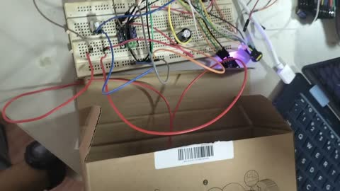
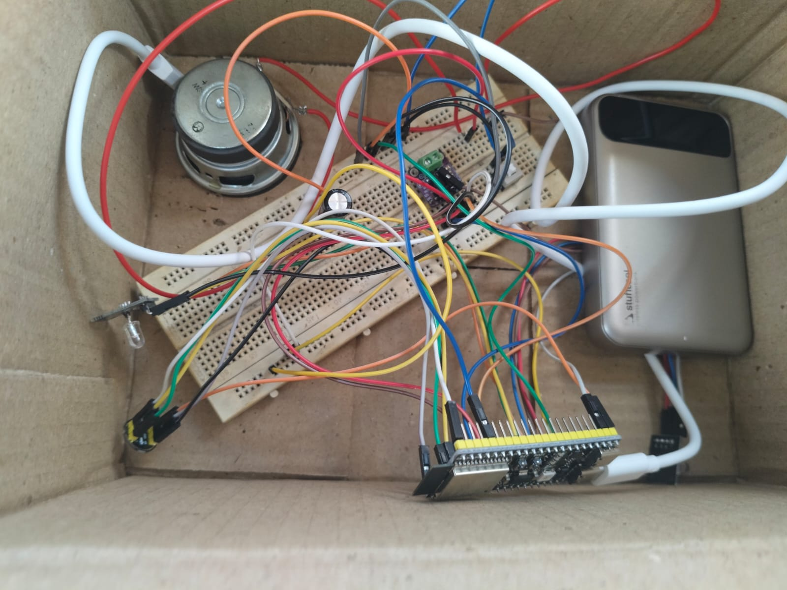
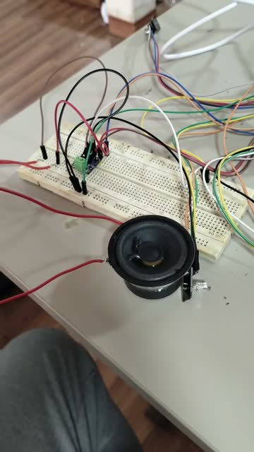
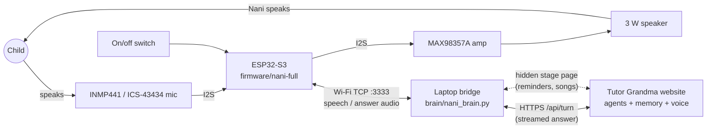

# Nani — an AI voice plush toy (ESP32-S3)

> A soft-toy "Nani" (grandmother) that a child can talk to in **Hindi, English or Hinglish**.
> Press the switch, speak, and Nani answers out loud, with the memory and personality of the
> [Tutor Grandma](https://tutor-grandma.vercel.app/stage) web app. Website reminders
> ("Aarav beta, paani pi lo!") also come out of the toy's speaker.

**Hardware add-on for the Tutor Grandma buildathon project**: the web app (agents, memory, voice) was
built by Hrishikesh Hundekari; this repository is the physical toy and the bridge that connects it.

## Demo

| End-to-end conversation (56 s) | Prototype packed in a box | First sound test (18 s) |
|---|---|---|
| [](docs/media/demo-conversation-56s.mp4) |  | [](docs/media/demo-2026-11-21.mp4) |
| [watch](docs/media/demo-conversation-56s.mp4) · more: [35 s](docs/media/demo-conversation-35s.mp4), [26 s](docs/media/demo-conversation-26s.mp4) | [another view](docs/media/prototype-in-box-wide.jpg) | [watch](docs/media/demo-2026-11-21.mp4) |

*Videos recorded 21–22 Nov 2026. In the conversation videos the laptop console shows what the toy heard
(`Aarav: …`) and Nani's streamed answer (`Nani: … [piece N]`) while the toy speaks it.*

## What it does

| | |
|---|---|
| 🔘 **One switch** | Latching push switch: every press toggles Nani awake / asleep |
| 👂 **Listens** | I2S MEMS mic, voice-activity detection, records until the child stops (0.7 s of silence) |
| 💬 **Answers** | Speech → laptop bridge → the website's `/api/turn` (speech-to-text, agents + memory, Nani's voice) → toy speaker |
| ⚡ **Feels quick** | Instant "Hmm, let me think!" from flash; answer plays **sentence by sentence** as it arrives (~3.5 s to first words) |
| 📢 **Website speaks through the toy** | Reminders and songs fired by the website's stage page play on the toy |
| 🔊 **Clean sound** | 400 Hz bass-cut filter + speech compression: louder and no crackle on a small 40 mm speaker |
| 🧠 **Offline mode** | `--offline`: laptop-only brain (Whisper + Ollama qwen3 + Windows voice), no internet |

## How it works



Full design: [docs/02-architecture.md](docs/02-architecture.md).

## Hardware (≈ ₹3,100 for the core build)

| Part | Use |
|---|---|
| ESP32-S3-DevKitC-1 **N16R8** | brain of the toy (Wi-Fi, I2S, 8 MB PSRAM) |
| INMP441 or ICS-43434 I2S mic | hearing |
| MAX98357A I2S amp + 3 W 4 Ω speaker | Nani's voice |
| 1000 µF capacitor across amp VIN/GND | steady 5 V on loud speech (doubled the clean volume) |
| Latching push switch | on / off |
| 2× RGB LEDs (eyes, optional) | blue = listening, purple = thinking, red = speaking |
| 5000 mAh power bank | runs the toy without a cable |

Pins, wiring and the full parts list: [docs/03-hardware.md](docs/03-hardware.md).

## Quick start

```powershell
# 1. Laptop side (Windows, Python 3.12, ffmpeg on PATH, Microsoft Edge installed)
pip install -r requirements.txt

# 2. Toy side: copy the Wi-Fi template and fill in a 2.4 GHz network
copy firmware\nani-full\secrets.example.h firmware\nani-full\secrets.h
```
3. Open `firmware/nani-full/nani-full.ino` in the Arduino IDE → Board **ESP32S3 Dev Module**,
   USB CDC On Boot **Enabled**, PSRAM **OPI PSRAM** → Upload.
4. Double-click **`start-nani.bat`** (it finds the toy on the Wi-Fi by itself).
5. Press the toy's switch and talk to Nani.

Step-by-step with the output you should see, and troubleshooting:
[docs/07-operations-runbook.md](docs/07-operations-runbook.md).

## Repository layout

```
firmware/nani-full/      main toy firmware (+ voice clips as headers, secrets.example.h)
firmware/tests/          mic-test, speaker-test, mic-to-laptop, mic-wifi: one sketch per hardware check
brain/                   nani_brain.py (laptop bridge), make_voice.py (voice clips -> headers)
tools/                   laptop helpers for the test sketches (play / record the mic)
tests/run_tests.py       automated checks of the laptop side (no hardware needed)
docs/                    full documentation, ADRs, beginner tutorial, evidence logs
start-nani.bat           one-click launcher for the laptop bridge
```

## Documentation

| If you want to… | Read |
|---|---|
| **Build it yourself from zero** (beginner) | [docs/tutorial/](docs/tutorial/README.md) |
| Understand the design | [docs/02-architecture.md](docs/02-architecture.md) |
| Wire and run it | [docs/03-hardware.md](docs/03-hardware.md), [docs/07-operations-runbook.md](docs/07-operations-runbook.md) |
| See measured results | [docs/06-results.md](docs/06-results.md) |
| Everything | [docs/README.md](docs/README.md) |

## Status

Working end to end on a breadboard prototype (21 Nov 2026): Hindi/Hinglish questions answered by the
website's Nani through the toy, on a power bank. Next: LED eyes on GPIO, fitting into the plush,
speaker enclosure. See [docs/10-known-issues-roadmap.md](docs/10-known-issues-roadmap.md).

## Credits

- **Tutor Grandma web app** (agents, memory, Nani's voice, `/api/turn`): Hrishikesh Hundekari.
- **Toy hardware, firmware and laptop bridge** (this repo): Rayon Biswas.
