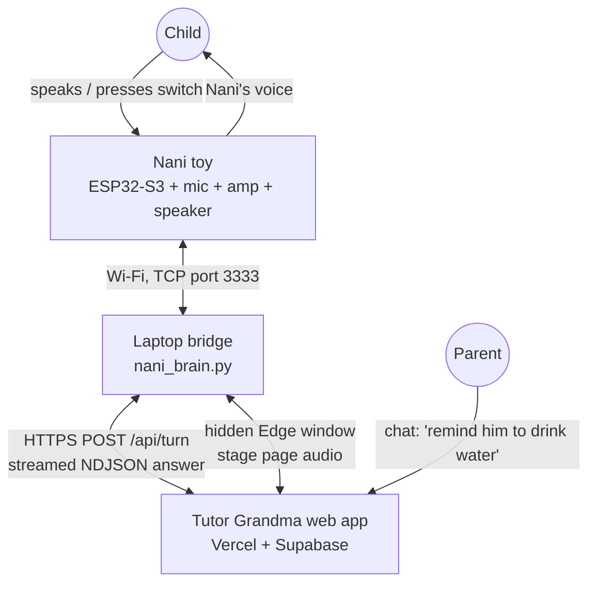
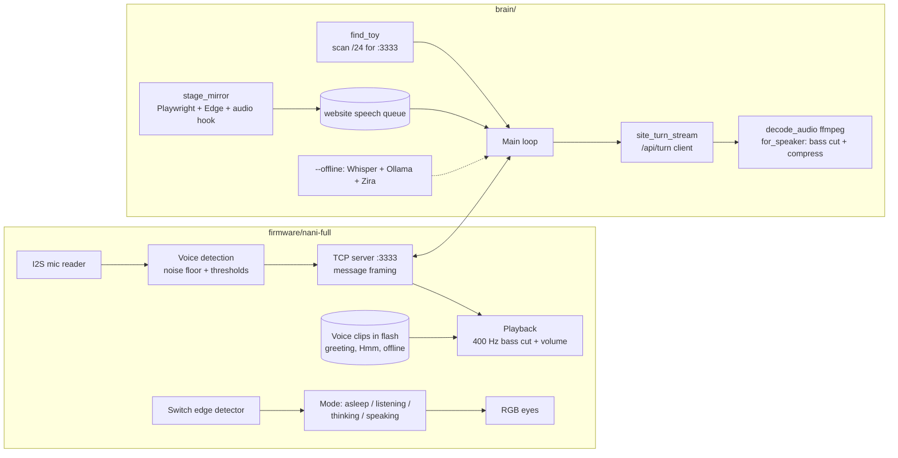
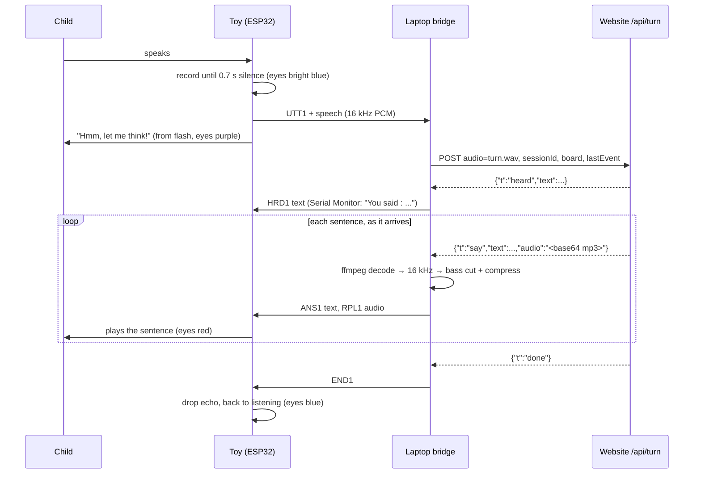

# 02 — Architecture

| | |
|---|---|
| **Document type** | Explanation (arc42-lite) |
| **Audience** | Engineers, reviewers |
| **Last updated** | 2026-11-22 |

## 1. System context



The toy never talks to the internet directly. The laptop bridge is the only component that knows
about the website.

## 2. Building blocks



| Component | Responsibility | Key entry points |
|---|---|---|
| Mic reader | 16 kHz, 32-bit I2S words → 16-bit samples | `micStart()`, `micFrame()` in `nani-full.ino` |
| Voice detection | Learns room noise, starts recording at 4× noise, stops after 0.7 s below 2.5× | `listenTick()`, `startRecording()` |
| Link (toy side) | TCP server, sends `UTT1`, reads `HRD1/ANS1/RPL1/END1/SAY1` | `askBrain()`, `websiteSpeech()`, `readExact()`, `writeMsg()` |
| Playback | Bass cut (biquad high-pass 400 Hz), gain = volume/0.8, I2S to amp | `playMono()`, `hpf()`, `ampOn()` |
| Voice clips | Greeting, "Hmm, let me think!", "Wait beta, I am waking up!" as C arrays | `nani_voice.h`, `nani_filler.h`, `nani_offline.h` |
| Switch | Debounced edge detector on GPIO 2, toggles awake/asleep | `switchPressed()`, `toggleNani()` |
| Bridge main loop | Waits for toy speech; while idle, forwards website speech | `main()` in `nani_brain.py` |
| Website client | Posts WAV to `/api/turn`, yields events as they stream in | `site_turn_stream()` |
| Audio conversion | Website MP3 → 16 kHz PCM → bass cut + compression | `decode_audio()`, `for_speaker()` |
| Stage mirror | Opens the stage page hidden and muted, hooks `AudioBufferSourceNode.start` | `stage_mirror()`, `HOOK_JS` |
| Auto-find | Tries all 254 addresses of the laptop's network for port 3333 | `find_toy()` |
| Voice clip tool | Windows Zira TTS → trim → bass cut → compress → C header | `make_voice.py` |

## 3. Runtime view: a conversation



## 4. Runtime view: website speech (reminders)

```mermaid
sequenceDiagram
    participant S as Stage page (hidden Edge)
    participant B as Bridge main loop
    participant T as Toy
    S->>S: scheduler fires "paani pi lo" job, plays Nani's audio
    S->>B: hook copies the AudioBuffer (float32, 48 kHz)
    B->>B: queue; when the toy is idle: resample to 16 kHz, bass cut + compress
    B->>T: SAY1, RPL1 audio, END1
    T->>T: awake? play it (eyes red) : read and discard
```

If website speech arrives in the middle of a conversation, the toy plays that block and then keeps
waiting for its answer (`askBrain()` handles `SAY1`).

## 5. Wire protocol (toy ↔ bridge)

Every message is `tag (4 ASCII bytes) + length (uint32, little-endian) + payload`.

| Tag | Direction | Payload |
|---|---|---|
| `UTT1` | toy → bridge | the child's speech, 16 kHz mono int16 |
| `HRD1` | bridge → toy | text the website heard (UTF-8) |
| `ANS1` | bridge → toy | one sentence of Nani's answer (UTF-8) |
| `RPL1` | bridge → toy | audio of that sentence, 16 kHz mono int16, already bass-cut and compressed |
| `END1` | bridge → toy | answer finished (empty) |
| `SAY1` | bridge → toy | website speech follows: `RPL1` pieces, then `END1` |

The website's own protocol (reverse-read from its public page code, see [ADR-0003](adr/0003-reuse-website-api-turn.md)):
`POST /api/turn` as `multipart/form-data` with `audio` (or `text`), `sessionId`, `board`,
`lastEvent`, `clockOffsetMs`; the reply is newline-delimited JSON with `t` = `heard`, `say`
(text + base64 audio), `fallback`, `done`.

## 6. Data and files

| Data | Where | Format |
|---|---|---|
| Wi-Fi network | `firmware/nani-full/secrets.h` (git-ignored) | C constants |
| Voice clips | `firmware/nani-full/nani_*.h` | `int16_t` arrays, 16 kHz mono, peak 28000 |
| Recordings (tools) | `recordings/` (git-ignored) | WAV 16 kHz mono |
| Website session | random UUID per bridge run | sent as `sessionId` |

## 7. Deployment and environment

| Item | Version / value |
|---|---|
| Board | ESP32-S3-DevKitC-1 N16R8 (16 MB flash, 8 MB OPI PSRAM) |
| Arduino-ESP32 core | 3.3.11 ([compile log](evidence/firmware-compile.txt)) |
| Arduino settings | ESP32S3 Dev Module, USB CDC On Boot Enabled, PSRAM OPI PSRAM, default partition |
| Laptop | Windows 11, Python 3.12, ffmpeg, Microsoft Edge, Playwright 1.64 |
| Offline mode | faster-whisper `small.en`, Ollama `qwen3`, Windows "Microsoft Zira" voice |
| Network | 2.4 GHz Wi-Fi; toy and laptop on the same LAN |

## 8. Cross-cutting concepts

- **Audio format everywhere on the toy:** 16 kHz, mono, signed 16-bit. Converted once, on the laptop.
- **Speaker protection is applied twice on purpose:** on the laptop before sending (so the loudness
  boost is not wasted on bass) and in the firmware for any sound (tones, recordings).
- **No overlapping audio:** the bridge only sends website speech while no conversation is running;
  the toy ignores its own echo by dropping 200 ms of mic audio after every playback.
- **Failure is spoken, not silent:** no bridge → "Wait beta, I am waking up!"; website error →
  "Sorry beta, Nani cannot reach her brain right now."
- **Secrets never in code:** Wi-Fi lives in git-ignored `secrets.h` ([ADR-0008](adr/0008-wifi-secrets-file.md)).

## 9. Decisions

See the [ADR index](adr/README.md).
