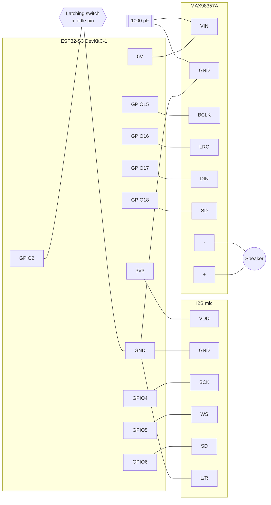
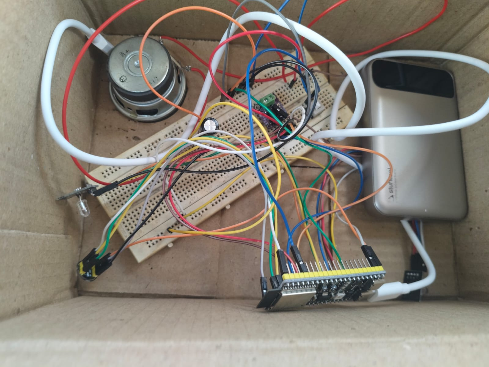
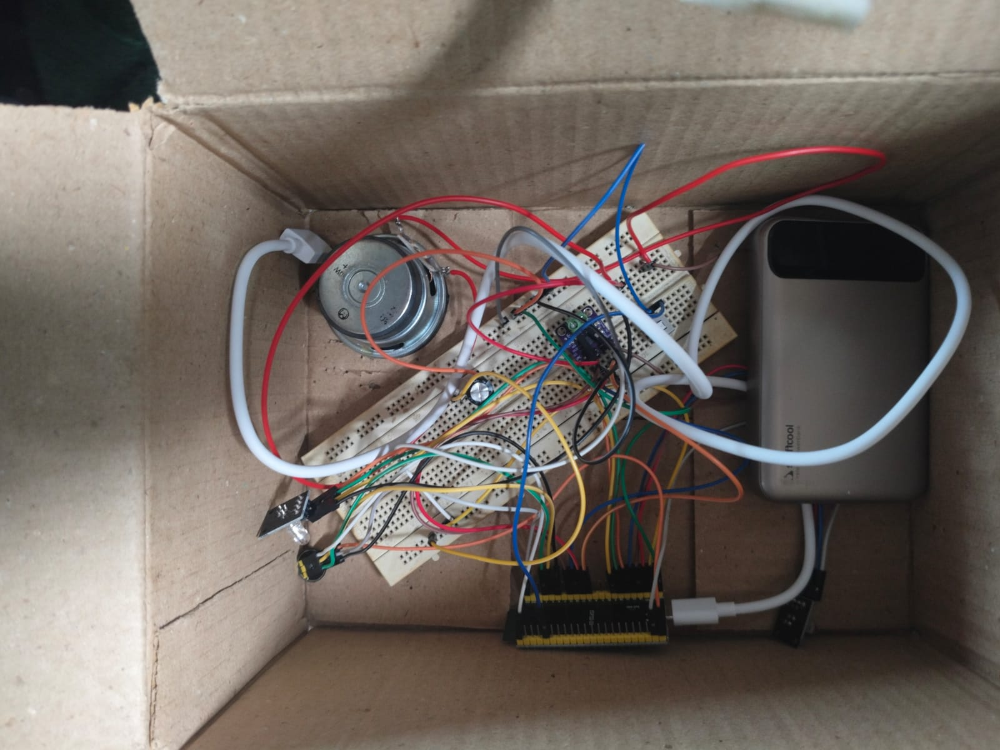

# 03 — Hardware

| | |
|---|---|
| **Document type** | Reference |
| **Audience** | Anyone building or repairing the toy |
| **Last updated** | 2026-11-22 |

## 1. Parts list (BOM)

Prices are November 2026 estimates for Indian online shops (Robu.in, Amazon.in), not live quotes.

### Must have

| # | Part | Exact part to search | Qty | ₹ each (est.) |
|---|---|---|---|---|
| 1 | Microcontroller | ESP32-S3-DevKitC-1 **N16R8** | 1 | 750 |
| 2 | Microphone | ICS-43434 I2S MEMS module (INMP441 is a drop-in, ~₹200) | 1 | 450 |
| 3 | Amplifier | MAX98357A I2S 3 W class-D module | 1 | 250 |
| 4 | Speaker | 3 W, 4 Ω, 40 mm | 1 | 80 |
| 5 | Capacitor | 1000 µF, 16 V electrolytic | 1 | 10 |
| 6 | On/off switch | 8×8 mm self-locking (latching) push switch, 6 pins | 1 | 10 |
| 7 | Eyes | 2× RGB LED (common cathode) + 6× 220 Ω resistors | 1 set | 50 |
| 8 | Power | 5000 mAh slim power bank + short USB-C **data** cable | 1 | 700 |
| 9 | Body | Ready-made plush, ~30–35 cm, zip at the back | 1 | 400 |
| 10 | Build | breadboard, jumper wires, perfboard + headers, pouch | 1 set | 310 |
| | **Total** | | | **≈ 3,010** |

### Nice to have

| Part | Why |
|---|---|
| Spare ESP32-S3 and spare mic | demo-day backup |
| FSR 402 force sensor | a softer "squeeze the paw" instead of a clicky button |
| Bigger speaker (4 Ω, 3–5 W, 50–66 mm) | more volume (see [06 — Results](06-results.md#4-speaker-volume)) |
| Small closed box for the speaker | louder, fuller sound |

## 2. Pin map (ESP32-S3)

| Part | Part pin | ESP32-S3 | Notes |
|---|---|---|---|
| Mic | VDD | **3V3** | never 5 V |
| Mic | GND | GND | |
| Mic | SCK / BCLK | GPIO **4** | I2S bit clock |
| Mic | WS / LRCL | GPIO **5** | I2S word select |
| Mic | SD / DOUT | GPIO **6** | I2S data in |
| Mic | L/R / SEL | GND | left channel |
| Amp | VIN | **5V** (VBUS) | from USB / power bank |
| Amp | GND | GND | |
| Amp | BCLK | GPIO **15** | |
| Amp | LRC | GPIO **16** | |
| Amp | DIN | GPIO **17** | |
| Amp | SD | GPIO **18** or unconnected | LOW = amp asleep (silent between sounds). Never to GND |
| Amp | GAIN | unconnected | 9 dB; GND = 12 dB, 100 kΩ to GND = 15 dB |
| Capacitor | + / − | amp VIN / amp GND | as close to the amp as possible; stripe = − |
| Speaker | + / − | amp screw terminals | **never** to GND or an ESP32 pin |
| Switch | middle pin of one row | GPIO **2** | internal pull-up, no resistor needed |
| Switch | an outer pin of the same row | GND | either end works |
| Left eye | R / G / B | GPIO 9 / 10 / 11 | through 220 Ω each |
| Right eye | R / G / B | GPIO 12 / 13 / 14 | through 220 Ω each; common pin to GND (type `a` if inverted) |

Avoid GPIO 0, 3, 45, 46 (boot strapping), 19/20 (USB) and 35–37 (used by the N16R8's PSRAM).

## 3. Wiring diagram

### The real build (22 Nov 2026)

| Top view | Wide view |
|---|---|
|  |  |

Everything is in one cardboard box: speaker (top left), breadboard with the MAX98357A amp and the
1000 µF capacitor (middle), power bank (right), ESP32-S3 on its yellow headers (front edge), mic and
switch on jumper leads. The pin table above is authoritative; it matches the pin constants in
[`nani-full.ino`](../firmware/nani-full/nani-full.ino).

## 4. Power

- One power bank output feeds the ESP32's USB port; the ESP32's **5V pin** feeds the amp.
  A 2-output power bank is not needed.
- Speaker bursts can pull ~0.5–0.7 A. Without the **1000 µF** capacitor the clean volume was half
  as high ([M4](evidence/development-measurements.md)).
- Some power banks switch off at low current. If the toy dies after a while, use one with an
  "always on" / low-current mode.

## 5. Assembly notes for the plush

| Topic | Guidance |
|---|---|
| Size | 30–35 cm plush with a plump body: the electronics pouch is ~12 × 8 × 4 cm and needs ~2 cm of stuffing around it |
| Access | Zip at the back: USB-C port reachable for re-flashing, power bank removable for charging |
| Speaker | Thin fabric on the chest or face (thick fur muffles), ideally in a small closed box |
| Mic | At the chin, away from the speaker, foam between them |
| Eyes | Behind the face fabric so they glow through |
| Switch | In a paw or at the back, padded |
| PCB | Not needed: dev kits on perfboard ([ADR-0001](adr/0001-dev-kits-and-i2s-audio.md)) |
