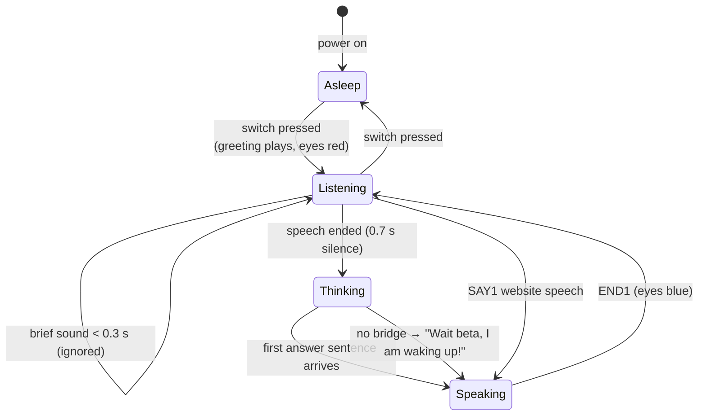
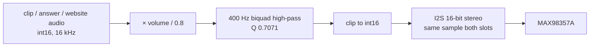

# 04 — Firmware (`firmware/nani-full`)

| | |
|---|---|
| **Document type** | Reference |
| **Audience** | Firmware developers |
| **Last updated** | 2026-11-22 |

One Arduino sketch, [`nani-full.ino`](../firmware/nani-full/nani-full.ino), plus three voice clip
headers and a git-ignored `secrets.h`. Arduino-ESP32 core 3.x, ESP-IDF I2S "std" driver.

## 1. Modes



| Mode | Eyes (R,G,B) | What runs |
|---|---|---|
| Asleep | off | switch check; website speech read and discarded |
| Listening | blue (0,0,120); bright blue (0,0,255) while recording | mic, voice detection, bridge accept, website speech |
| Thinking | purple (120,0,160) | `UTT1` sent, "Hmm, let me think!" plays, waiting for the answer |
| Speaking | red (200,0,0) | sentences play as they arrive |

The switch is read in the main loop, so a press during an answer takes effect when Nani finishes.

## 2. Audio input

| Setting | Value | Where |
|---|---|---|
| Sample rate | 16 000 Hz, mono | `RATE` |
| Frame | 320 samples = 20 ms | `FRAME` |
| I2S word | 32-bit, left slot; sample = `word >> 14` | `MIC_SHIFT` |
| Recording buffer | 8 s in PSRAM (3 s without PSRAM) | `MAX_SECONDS` |
| Pre-roll | last 300 ms kept so the first word isn't cut | `PREROLL_FRAMES = 15` |

### Voice detection

1. At start-up the room noise level (RMS of 25 frames, 0.5 s) becomes `noiseFloor`.
2. While idle, `noiseFloor` slowly follows quiet frames (`0.95·old + 0.05·new`).
3. **Start** when a frame's RMS > `max(4 × noiseFloor, 300)`.
4. **Silence** = RMS < `max(2.5 × noiseFloor, 180)`. **Stop** after 700 ms of silence.
5. Recordings with less than 300 ms of real speech are ignored (bumps, clicks).
6. Trailing silence is trimmed to 200 ms before sending.

Type `d` in the Serial Monitor to print `level / room / start>` live while tuning.

## 3. Audio output



| Setting | Value | Why |
|---|---|---|
| Volume | 0.60 default, 0.05–0.80 | 0.60 tested clean with the capacitor; 0.80 = full digital level |
| Bass cut | 400 Hz, 2nd-order Butterworth (RBJ cookbook) | the 40 mm speaker crackles on low notes ([ADR-0005](adr/0005-speaker-bass-cut-and-compression.md)) |
| Amp sleep | SD pin LOW between sounds; filter state reset on each `ampOn(true)` | no hiss while listening, no click at start |
| Echo guard | 10 mic frames (200 ms) dropped after every playback | Nani must not hear herself |

## 4. Bridge link

The toy is a **TCP server on port 3333**; the laptop connects to it. This means the toy never needs
to know the laptop's address. Messages are listed in [02 — Architecture §5](02-architecture.md#5-wire-protocol-toy--bridge).

| Function | Role |
|---|---|
| `brainConnected()` | accepts the bridge every 500 ms while listening or asleep |
| `askBrain()` | sends `UTT1`, plays the filler, then reads messages: prints `HRD1`/`ANS1`, plays each `RPL1`, finishes on `END1`; plays a `SAY1` block if one sneaks in |
| `websiteSpeech(play)` | while idle: reads a `SAY1` block, plays it (awake) or discards it (asleep) |
| `readExact()` | reads exactly n bytes; times out only after a quiet gap (10 s per piece, 90 s total wait) |

## 5. Voice clips in flash

| Header | Text | Length | Made by |
|---|---|---|---|
| `nani_voice.h` | "Hello Aarav! I am Nani. Did you drink water today?" | 5.17 s | `python brain/make_voice.py "<text>"` |
| `nani_filler.h` | "Hmm, let me think!" | 1.54 s | `... --name FILLER` |
| `nani_offline.h` | "Wait beta, I am waking up!" | 1.81 s | `... --name OFFLINE` |

Clips are pre-processed on the laptop (trim, bass cut, compression, peak 28000), so the firmware plays
them with `gain = volume / 0.8`.

## 6. Serial Monitor (115200)

| Key | Action |
|---|---|
| `+` / `-` | volume ±0.05 |
| `g` | say the greeting (when awake) |
| `w` | wake / sleep, same as the switch |
| `d` | live mic level |
| `a` | flip LED type (common anode / cathode) |
| `h` | help |

Typical log:
```
*** Nani is AWAKE ***
MODE: LISTENING (eyes blue)
Heard a voice, recording...
MODE: THINKING (eyes purple)
[time] speech sent: 41 ms
[time] filler done: 1580 ms
You said : Apple कौन से color का होता है?
Nani says: Apple laal, hara,
MODE: SPEAKING (eyes red)
[time] Nani starts answering: 3620 ms after the silence wait
[time] answer finished: 11240 ms (3 pieces)
MODE: LISTENING (eyes blue)
```
(The `[time]` numbers above are illustrative; see [06 — Results](06-results.md) for measured values.)

## 7. Memory and flash

| Resource | Use |
|---|---|
| Flash | 1,221,578 of 1,310,720 bytes (93%) with the default partition ([compile log](evidence/firmware-compile.txt)) |
| PSRAM | 8 s recording (256 KB) + 15 s answer (480 KB) |
| More room | Tools → Partition Scheme → *16M Flash (3MB APP/9.9MB FATFS)* |

## 8. Test sketches (`firmware/tests/`)

| Sketch | Checks | Needs |
|---|---|---|
| `mic-test` | wiring (data present, which slot), room noise, voice PASS/FAIL, live meter | mic |
| `speaker-test` | beeps, tones, sweep, melody in 3 octaves, sentence, silence test (`z`), parrot (`p`) | amp, speaker, mic for `p` |
| `mic-to-laptop` | mic over USB to the laptop speaker / WAV file (`tools/play_mic.py`, `tools/record_wav.py`) | mic, USB |
| `mic-wifi` | mic over Wi-Fi to the laptop speaker (`tools/play_wifi.py`) | mic, Wi-Fi |

How to use each one: [07 — Runbook §5](07-operations-runbook.md#5-hardware-checks-one-part-at-a-time).
