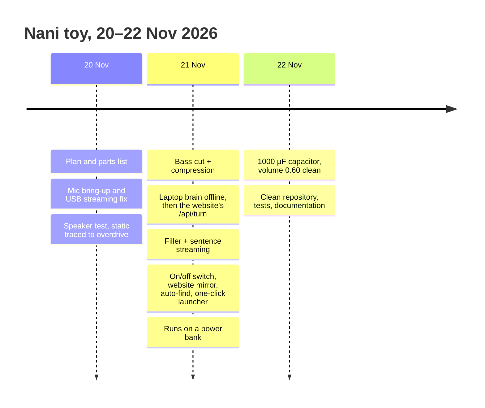

# 09 — Project history

| | |
|---|---|
| **Document type** | Record |
| **Audience** | Reviewers, future maintainers |
| **Last updated** | 2026-11-22 |

The project was built in a working folder over three days and published as this repository's first
commit on 2026-11-22, so there are no per-phase commit hashes. Each phase below names the files and
evidence that came out of it.

## Phase 1 — Plan and parts (20 Nov)
- The senior asked for a hardware plan "in sync with the agentic software side" and a components list.
- Parts list with prices; teammates proposed the ICS-43434 mic (newer than the end-of-life INMP441)
  and an all-in-one board; a custom PCB was rejected for time ([ADR-0001](adr/0001-dev-kits-and-i2s-audio.md)).
- Behaviour agreed in the group: switch on, squeeze to talk / eyes blue while thinking, red while
  speaking, reminders spoken by Nani, Nani asks "did you do it?".

## Phase 2 — Hearing (20 Nov)
- Mic streamed to the laptop over USB played only static. Counting bytes between packet headers
  showed every 644-byte packet cut to ~262 bytes: the firmware wrote with a zero timeout into a small
  USB buffer. Fixed by a 4 KB buffer and sending whole packets only ([M1](evidence/development-measurements.md)).
- `mic-test` added so the mic can be checked in the Arduino Serial Monitor alone.
- `record_wav.py` saved the mic to WAV; the builder confirmed the mic hears clearly.

## Phase 3 — Speaking (20–21 Nov)
- `speaker-test` with beeps, tones, melody; the toy spoke a sentence generated by the Windows voice.
- A "big hiss" was traced step by step: file clean (−90 dB), digital silence quiet, 0.10 volume clean
  → speaker overdrive, worst below ~300 Hz ([M2](evidence/development-measurements.md)).
- 280 Hz bass cut → 0.25 clean; raised to 400 Hz → 0.30 clean; compression +7.9 dB louder
  ([ADR-0005](adr/0005-speaker-bass-cut-and-compression.md)).

## Phase 4 — Thinking (21 Nov)
- First a laptop-only brain: faster-whisper + Ollama qwen3 + Zira (13.1 s per answer).
- Reading the website's public page code showed `/api/turn` already does hear → think → speak.
  One test turn: 7.2 s, Hinglish answer in Nani's own voice ([ADR-0003](adr/0003-reuse-website-api-turn.md)).

## Phase 5 — Integration (21 Nov)
- Toy could not join Wi-Fi: the network was 5 GHz (`sra_5G`); switched to the router's 2.4 GHz `sra`.
- Latency: instant filler + sentence-by-sentence playback; a buffering bug in `iter_lines()` found by
  timing a fake website ([ADR-0004](adr/0004-filler-and-sentence-streaming.md)).
- Latching on/off switch, edge-triggered ([ADR-0007](adr/0007-edge-triggered-latching-switch.md)).
- Website speech on the toy by mirroring the stage page's audio ([ADR-0006](adr/0006-mirror-stage-page-audio.md)).
- The toy's address changed (`.87` → `.187`), so the bridge now finds the toy itself; `start-nani.bat`.
- Five live Hindi/Hinglish turns on a power bank ([live log](evidence/live-session-2026-11-21.txt)).

## Phase 6 — Polish and publish (21–22 Nov)
- 1000 µF capacitor across the amp: clean volume 0.30 → 0.60.
- Clean repository (only working files; Wi-Fi moved to a git-ignored `secrets.h`,
  [ADR-0008](adr/0008-wifi-secrets-file.md)), automated tests, this documentation.

## Superseded work (kept out of the repository)
| Sketch | Why it was dropped |
|---|---|
| `bench-test` | early all-in-one test; replaced by the focused `mic-test` and `speaker-test` |
| `nani-modes` | listen/speak demo that played the child's words back; replaced by `nani-full` |
