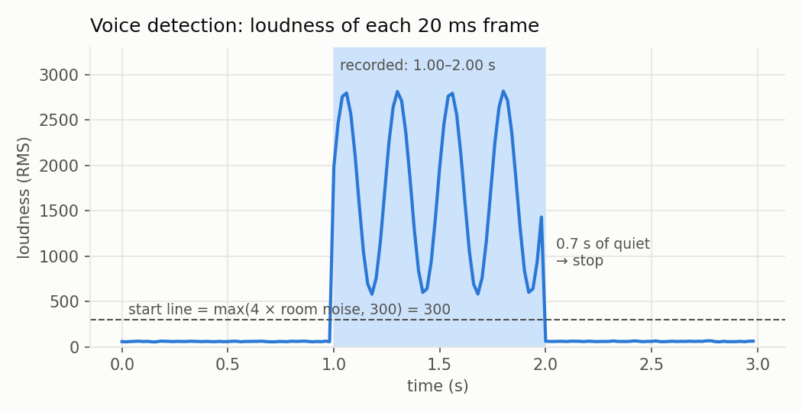

# 2 — Hearing: when does the child speak?

| | |
|---|---|
| **Document type** | Tutorial |
| **Audience** | Beginners |
| **Last updated** | 2026-11-22 |

**You will build:** [`code/ch02_voice_detect.py`](code/ch02_voice_detect.py) · **Full version:**
`listenTick()` and `startRecording()` in [`nani-full.ino`](../../firmware/nani-full/nani-full.ino)

## 💡 Idea

Think of a teacher in a classroom. The room always hums a little: fans, traffic. The teacher knows how loud
that hum normally is. When a child speaks *clearly louder* than the hum, the teacher starts listening; when
it has been quiet for a moment, the teacher knows the child is done.

That's **voice activity detection** (VAD):
1. Learn the room's normal loudness (the **noise floor**).
2. **Start** recording when a frame is more than **4×** the noise floor.
3. **Stop** after **0.7 s** in a row below **2.5×** the noise floor.

Using two different lines (4× to start, 2.5× to stop) stops the recording from flickering on and off in
the quiet gaps between syllables.



## The code

```python
START_FACTOR = 4.0        # speech = this many times louder than the room
STOP_FACTOR = 2.5         # quieter than this counts as silence
MIN_START_RMS = 300.0     # never trigger on anything quieter than this
END_SILENCE_MS = 700      # this much silence = the child has finished
FRAME_MS = 20


def detect_speech(samples):
    """Return (start_sample, end_sample) of the first utterance, or None."""
    frames = [samples[i:i + FRAME] for i in range(0, len(samples) - FRAME + 1, FRAME)]
    noise = np.mean([rms(f) for f in frames[:25]])          # first 0.5 s = room noise
    recording, start, silence_ms = False, 0, 0
    for n, f in enumerate(frames):
        level = rms(f)
        if not recording:
            if level > max(noise * START_FACTOR, MIN_START_RMS):
                recording, start, silence_ms = True, n, 0
            else:
                noise = 0.95 * noise + 0.05 * level          # slowly follow the room
        else:
            if level > max(noise * STOP_FACTOR, MIN_START_RMS * 0.6):
                silence_ms = 0
            else:
                silence_ms += FRAME_MS
            if silence_ms >= END_SILENCE_MS:
                end = n + 1 - END_SILENCE_MS // FRAME_MS      # back up to where speech ended
                return start * FRAME, end * FRAME
    return None
```

- `MIN_START_RMS = 300` protects a *very* quiet room: 4 × a tiny noise floor would trigger on a breath.
- `noise = 0.95 * noise + 0.05 * level` lets the noise floor drift if the fan gets louder, but only while
  nobody is speaking.
- The last line backs up by the 0.7 s of silence, so the clip ends where the speech ended.

## Try it

```powershell
python ch02_voice_detect.py
```

## ✅ Check

```
speech found from 1.00 s to 2.00 s (real speech: 1.00 s to 2.00 s)
```

## ⚠️ Common mistakes

| Symptom | Cause |
|---|---|
| Records forever in a noisy room | stop line too low; raise `STOP_FACTOR` |
| Cuts the child off mid-sentence | `END_SILENCE_MS` too short for slow speakers |
| Triggers on a table bump | no minimum speech length; the full version ignores < 0.3 s |
| Misses the first word | no pre-roll; the full version keeps the 300 ms *before* the trigger |

## Now with hardware: the mic

1. Wire the I2S mic: VDD → **3V3**, GND → GND, SCK → GPIO 4, WS → GPIO 5, SD → GPIO 6, L/R → GND
   ([03 — Hardware](../03-hardware.md)).
2. Upload [`firmware/tests/mic-test`](../../firmware/tests/mic-test/mic-test.ino) and open the Serial
   Monitor at 115200. You should see `PASS: mic is sending data`, a room-noise level, and
   `PASS: the mic clearly picks up your voice`.

## In the full project

Same rules, plus: a 300 ms **pre-roll** ring buffer, ignoring utterances under 0.3 s, trimming trailing
silence to 200 ms, recordings up to 8 s in PSRAM, and the eyes turning bright blue while recording.

Next: [3 — Speaking](03-speaking.md).
