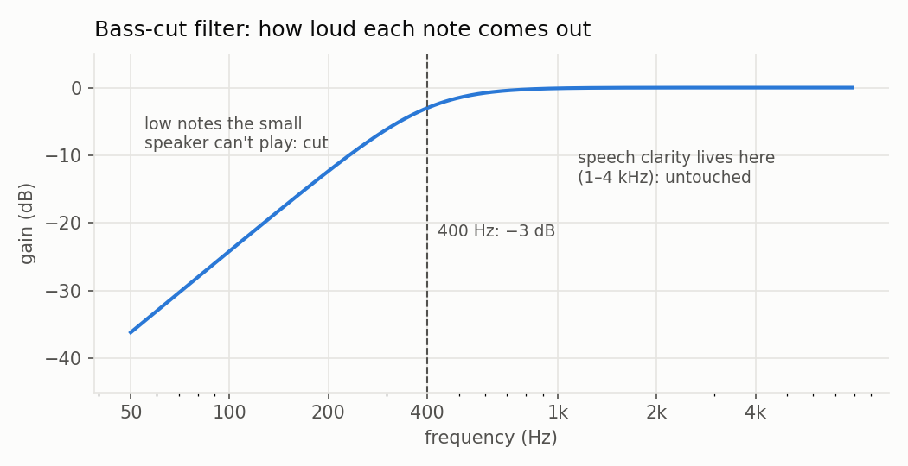

# 3 — Speaking: a small speaker that doesn't crackle

| | |
|---|---|
| **Document type** | Tutorial |
| **Audience** | Beginners |
| **Last updated** | 2026-11-22 |

**You will build:** [`code/ch03_speaker_filter.py`](code/ch03_speaker_filter.py) · **Full version:**
`hpfSetup()` / `hpf()` / `playMono()` in [`nani-full.ino`](../../firmware/nani-full/nani-full.ino),
`bass_cut()` in [`brain/make_voice.py`](../../brain/make_voice.py)

## 💡 Idea

A speaker makes sound by pushing a paper cone back and forth. **Low notes need big pushes**: the same
loudness at 200 Hz moves the cone far more than at 2000 Hz. A tiny 40 mm speaker hits its limit on low
notes first, and then it **crackles**. When we built Nani, what sounded like "static" was exactly this.

The fix is a **bass cut** (a *high-pass filter*): turn low notes down before they reach the speaker.
Speech stays clear, because what makes words understandable lives at 1–4 kHz.



A digital filter is just a small recipe that makes each output sample from the current input sample and
the last two inputs and outputs, using 5 fixed numbers. This "biquad" recipe comes from a classic
reference, the *Audio EQ Cookbook*.

## The code

```python
def highpass_coefficients(cutoff=CUTOFF_HZ, rate=RATE, q=0.7071):
    """The 5 numbers that define the filter (same formula as the firmware)."""
    w0 = 2 * math.pi * cutoff / rate
    alpha = math.sin(w0) / (2 * q)
    c = math.cos(w0)
    a0 = 1 + alpha
    b0, b1, b2 = (1 + c) / 2 / a0, -(1 + c) / a0, (1 + c) / 2 / a0
    a1, a2 = -2 * c / a0, (1 - alpha) / a0
    return b0, b1, b2, a1, a2


def bass_cut(samples):
    """Run the filter sample by sample, exactly like the ESP32 does in hpf()."""
    b0, b1, b2, a1, a2 = highpass_coefficients()
    x1 = x2 = y1 = y2 = 0.0
    out = np.empty(len(samples))
    for i, x in enumerate(samples):
        y = b0 * x + b1 * x1 + b2 * x2 - a1 * y1 - a2 * y2
        x2, x1, y2, y1 = x1, x, y1, y
        out[i] = y
    return out
```

- `x1, x2` are the last two inputs, `y1, y2` the last two outputs: the filter's "memory".
- `q = 0.7071` gives the smoothest curve (no bump near the cutoff).
- **dB (decibels)** compares loudness: 0 dB = unchanged, −6 dB ≈ half the swing, −20 dB = a tenth.

## Try it

```powershell
python ch03_speaker_filter.py
```

## ✅ Check

```
  100 Hz:  -24.1 dB
  200 Hz:  -12.3 dB
  400 Hz:   -3.0 dB
 1000 Hz:   -0.3 dB
 3000 Hz:   -0.1 dB
```
The real project's automated test measures the same filter: 200 Hz −12.3 dB, 400 Hz −3.0 dB
([test output](../evidence/test-output.txt)).

## ⚠️ Common mistakes

| Symptom | Cause |
|---|---|
| Speech sounds tinny and quiet | cutoff too high (e.g. 1 kHz) |
| Still crackles on loud speech | volume too high for the speaker, or no capacitor on the amp's power |
| A click when sound starts | filter memory left over from the last sound: reset `x1..y2` to 0 (the firmware does it in `ampOn(true)`) |
| Hiss even when nothing plays | not a filter problem: power or ground noise (use the `z` test) |

## Now with hardware: the amp and speaker

1. Wire the MAX98357A: VIN → **5V**, GND → GND, BCLK → 15, LRC → 16, DIN → 17, SD → 18; speaker to the
   amp's + and − terminals; a 1000 µF capacitor across VIN and GND (stripe to GND).
2. Upload [`firmware/tests/speaker-test`](../../firmware/tests/speaker-test/speaker-test.ino). You'll hear
   3 beeps and a sentence. Type `m`, `n`, `o` to hear a melody in three octaves: on a small speaker the
   low one sounds worst. That's this chapter, heard with your own ears.

## In the full project

The same filter runs on every sound the toy plays. The laptop also applies it, then **compresses**
speech (quiet syllables up, loud ones down) so it sounds about 8 dB louder at the same peak
([06 — Results](../06-results.md)). The real investigation that found the cause of the crackle is in
[ADR-0005](../adr/0005-speaker-bass-cut-and-compression.md).

Next: [4 — Talking over Wi-Fi](04-talking-over-wifi.md).
