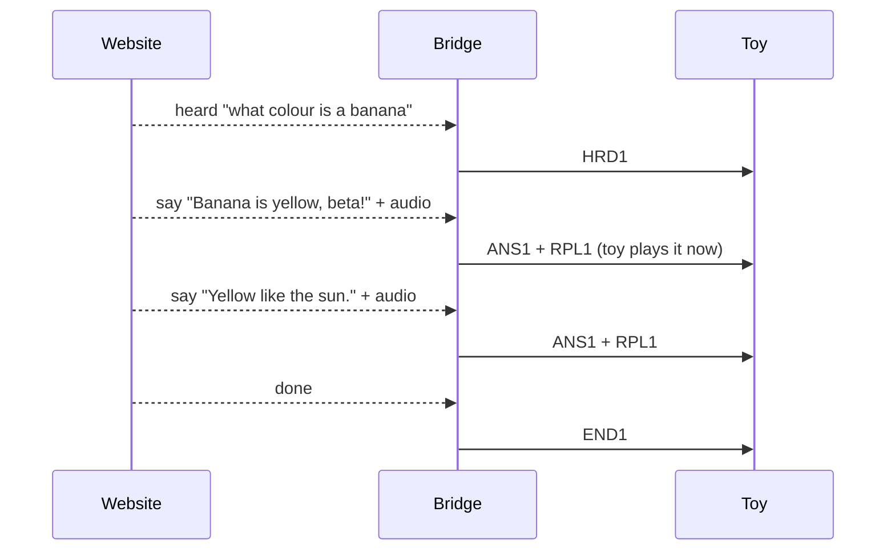

# 5 — The bridge: fast answers

| | |
|---|---|
| **Document type** | Tutorial |
| **Audience** | Beginners |
| **Last updated** | 2026-11-22 |

**You will build:** [`code/ch05_mini_brain.py`](code/ch05_mini_brain.py) · **Full version:**
`site_turn_stream()` and `main()` in [`brain/nani_brain.py`](../../brain/nani_brain.py), `askBrain()` in
[`nani-full.ino`](../../firmware/nani-full/nani-full.ino)

## 💡 Idea

When you ask a friend a question, they don't stay silent for 7 seconds and then say a whole paragraph.
They say "hmm…" and start answering while still thinking. The AI website works like that too: it sends
its answer **one sentence at a time**, as a stream of lines.

So the bridge does two things to make Nani feel quick:
1. The toy says **"Hmm, let me think!"** from its own memory the instant it sends the question.
2. The bridge passes each sentence to the toy **the moment it arrives**, so Nani starts talking while
   the website is still writing the rest.



## The code

```python
def bridge(lines, to_toy):
    """Read the website stream line by line and pass every piece on straight away."""
    for line in lines:
        ev = json.loads(line)
        if ev["t"] == "heard":
            send_msg(to_toy, b"HRD1", ev["text"].encode())
        elif ev["t"] == "say":
            send_msg(to_toy, b"ANS1", ev["text"].encode())
            send_msg(to_toy, b"RPL1", base64.b64decode(ev["audio"]))
        elif ev["t"] == "done":
            break
    send_msg(to_toy, b"END1", b"")
```

- Each line is **JSON** (text-shaped data). `"t"` says what kind of event it is.
- Audio inside JSON travels as **base64** (binary written with letters); `b64decode` turns it back.
- `fake_website()` sleeps 0.5 s before each sentence, like an AI thinking.

## Try it

```powershell
python ch05_mini_brain.py
```

## ✅ Check

```
 0.0 s  HRD1  what colour is a banana
 0.5 s  ANS1  Banana is yellow, beta!
 0.5 s  RPL1  play 0.3 s of audio
 1.0 s  ANS1  Yellow like the sun.
 1.0 s  RPL1  play 0.3 s of audio
 1.5 s  ANS1  What else is yellow?
 1.5 s  RPL1  play 0.3 s of audio
 1.5 s  END1  answer finished
```
The first sentence is "played" at 0.5 s, not after the whole answer (1.5 s).

## ⚠️ Common mistakes

| Symptom | Cause |
|---|---|
| Every sentence arrives late, one behind | the reader buffers before handing lines over. This really happened: `requests`' `iter_lines()` waits for 512 bytes, so each event was held until the next one. The fix is `iter_content(chunk_size=None)` ([ADR-0004](../adr/0004-filler-and-sentence-streaming.md)) |
| Website speech and an answer overlap | send website speech only when no conversation is running |
| Toy hears itself and answers itself | throw away the mic audio recorded while the speaker played (the firmware drops 200 ms) |

## In the full project

The real bridge posts the toy's speech to the web app's `/api/turn`, converts each sentence's MP3 to the
toy's format with ffmpeg, applies the bass cut and compression, and also **mirrors the website's own
speech** (reminders) to the toy. Measured on the real toy: Nani's first words 3.4–3.8 s after the speech
reached the laptop ([live log](../evidence/live-session-2026-11-21.txt)).

Next: [6 — Measure honestly](06-measure-honestly.md).
